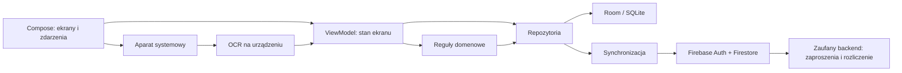

# Milestone 2 — architektura i model danych

Status: projekt techniczny i wstępny szkielet; integracja Room, Firebase, OCR i synchronizacji nie jest jeszcze zaimplementowana. Dokument uwzględnia ustalenia z milestone 1, w tym grupy 2–4 osób i jednego pingwinka. Wcześniejsze wzmianki o parze w planie M2 zastępujemy grupą.

## 1. Architektura



- **UI:** Compose wyświetla dane, komunikaty oraz informację, czy wynik jest lokalny, oczekujący, potwierdzony albo odrzucony. Nie oblicza punktów samodzielnie.
- **ViewModel:** udostępnia stan ekranu i obsługuje działania użytkownika, przetrwa odtworzenie ekranu. Reguły powinny być czystymi funkcjami Kotlin możliwymi do testowania.
- **Repozytoria:** dostarczają dane z lokalnej bazy i przyjmują polecenia. Jednoznacznie rozdzielają dane prywatne właściciela od danych udostępnianych grupie.
- **Room/SQLite:** lokalne źródło danych dla UI i trwała kolejka operacji. Po poprawnym potwierdzeniu wyniki trafiają do lokalnej kopii.
- **Backend:** wspólny autorytatywny stan grupy i rozliczeń; użytkownicy nie nadają sobie członkostwa ani punktów zdrowia pingwinka przez dowolny zapis. Zaufana operacja sprawdza zaproszenia, granice grupy, terminy i rozliczenia.
- **Aparat i OCR:** zdjęcie jest analizowane lokalnie. OCR odczytuje tekst, nie dowodzi wykonania nawyku; w pierwszej wersji obsługa wybranych formatów.

## 2. Model domenowy

| Obiekt | Najważniejsze pola | Reguły |
|---|---|---|
| Użytkownik | `userId`, nazwa, ustawienia, strefa/powiadomienia | Dane logowania przez dostawcę tożsamości. |
| Grupa | `groupId`, nazwa, `timeZoneId`, czas utworzenia | 2–4 osoby jako docelowy skład; po utworzeniu jedna osoba może oczekiwać na zaproszonych. |
| Członkostwo | `groupId`, `userId`, rola, czas dołączenia, data pełnego udziału | Pierwszy niepełny tydzień: pomaga, ale nie szkodzi. Obsługa wyjścia i usuwania wymaga decyzji. |
| Zaproszenie | losowy kod, grupa, ważność, status, wykorzystanie | Kod jednorazowy, weryfikacja i przyjęcie członka atomowo przez zaufany backend; bez ujawniania listy zaproszeń obcym. |
| Nawyk | `habitId`, właściciel, typ, nazwa, aktywność | Początkowo czytanie, sen i kroki; historia pozostaje po archiwizacji. |
| Wersja planu | `habitId`, wartość celu, jednostka, dni tygodnia, okres obowiązywania | Cel z dnia wykonania jest zapamiętany; zmiany od poniedziałku. Rozstrzygnąć wznowienie i strefę grupy. |
| Wykonanie | `userId`, `habitId`, data lokalna, wynik, cel z dnia, źródło, status | Jeden wpis na użytkownika, nawyk i dzień. Prywatny wynik i źródło nie są widoczne znajomym. |
| Wynik weryfikacji | rodzaj `OCR` / ręcznie, status, dane odczytu, czas | Zdjęcie tymczasowe, bez udostępniania grupie. Wpis ręczny snu daje takie same punkty. |
| Publiczny postęp | grupa, osoba, nawyk, data, status wykonania | Współdzielone jedynie nazwa nawyku i status; bez godzin snu, liczby kroków, OCR i zdjęć. |
| Pingwinek / epoka | `penguinId`, grupa, stan, zdrowie, początek, koniec | Jeden aktywny pingwin; po śmierci nowa epoka, historia i grupa pozostają. |
| Rozliczenie | grupa, dzień/tydzień, członkowie, wyniki, wersja reguł, status | Wspólna decyzja liczona autorytatywnie; zdrowy tygodniowo, chory dziennie. |
| Streak i przedłużenie | osoba, licznik dni, data, koszt, status i termin | >75% dziennie; odpoczynek zwiększa licznik; koszt przedłużenia 14 dni. Atomowe zużycie po stronie zaufanej. |

**Punkty:** nawyk maksymalnie 10, proporcjonalnie do celu do jednego miejsca; sen poniżej 5 h = 0. Do obliczeń używać liczb całkowitych w dziesiątych częściach punktu i porównywać progi bez zaokrąglania procentów. Dokładna kolejność zaokrąglania i czasy snu >24 h wymagają testów/specyfikacji.

## 3. Lokalna baza SQLite

Proponowane tabele Room: `users`, `groups`, `memberships`, `habits`, `habit_plan_versions`, `habit_entries`, `verification_results`, `public_progress`, `penguin_epochs`, `group_settlements`, `streaks`, `extensions`, `pending_operations`. Klucze obce, indeksy `groupId`/data i ograniczenie `UNIQUE(userId, habitId, localDate)` zapobiegają duplikacji. Dla każdej wersji schematu przygotować migrację i test na danych z poprzedniej wersji.

Wpis oraz operację wysyłki zapisywać w jednej transakcji Room. Operacja ma stałe `operationId`, rodzaj, wersję, status, liczbę prób i wynik. Dla powtórzenia użyć tego samego ID. Wyczyścić dane lokalne przy wylogowaniu lub zmianie konta zgodnie z uzgodnioną polityką. Baza przechowuje dane prywatne: ograniczyć ich zakres, unikać logowania odczytów i nie zapisywać zdjęć bez potrzeby.

## 4. Firestore i dostęp

Przykładowe ścieżki — schemat, nie gotowe reguły:

```text
users/{userId}/habits/{habitId}           # prywatne ustawienia właściciela
users/{userId}/entries/{entryId}          # prywatne wyniki i OCR
users/{userId}/operations/{operationId}   # żądania i potwierdzenia operacji
 groups/{groupId}                         # podstawowe dane grupy
 groups/{groupId}/members/{userId}        # członkostwo
 groups/{groupId}/publicProgress/{id}      # nazwa nawyku i status, bez wartości
 groups/{groupId}/penguins/{penguinId}     # wspólny stan i historia
 groups/{groupId}/settlements/{id}         # status i wynik rozliczenia
```

Ścieżki `groups` należy zapisać bez początkowej spacji (użyto jej wyłącznie dla czytelności bloku). Reguły Firestore powinny ograniczać odczyt `users/{uid}` do właściciela, a grupy do aktualnych członków; pola wyników prywatnych nie mogą trafiać do dokumentów grupowych. Uprawnienia do modyfikacji członkostwa, salda streaka, rozliczenia i zdrowia pingwina wyłącznie przez zaufany backend. Testować osobno odczyt, zapis, nową osobę, obce konto, wygasłe zaproszenie i pełną grupę. Same reguły nie zapewniają bezpieczeństwa błędnie zaprojektowanej funkcji backendowej.

## 5. Offline, termin i synchronizacja

1. Odczyt UI pochodzi z Room; wpis powstaje lokalnie, a jego status to `PENDING`. Zdjęcie można przeanalizować lokalnie, jeśli model jest dostępny.
2. WorkManager uruchamia ponowienie po dostępności sieci. Room jest jedyną kolejką poleceń; nie należy równolegle traktować zapisu offline Firestore jako drugiej niezależnej kolejki tych samych operacji.
3. Backend przyjmuje operację idempotentnie, weryfikuje tożsamość, członkostwo, termin oraz przedłużenie, zapisuje potwierdzony wynik i wyprowadza wyłącznie dozwolony publiczny status. `operationId` i unikalny klucz wpisu zapobiegają ponownemu naliczeniu.
4. Do standardowego terminu decyduje **czas przyjęcia przez backend**, a nie zegar telefonu: do końca dnia w strefie grupy. Po upływie terminu odrzucić nieprzedłużony wpis z jasnym wyjaśnieniem. Użytkownik musi zdążyć wysłać dane online; nie da się wiarygodnie zagwarantować terminowego przyjęcia całkowicie offline.
5. Przedłużenie kosztuje 14 dni streaka i daje czas do końca następnego dnia. Jego autoryzacja i odjęcie salda muszą być atomowe. **Do decyzji:** kiedy i czy offline można je wykupić, co dzieje się w trakcie 24-godzinnego okna z wynikiem grupy i kiedy wynik jest ostateczny. Sama operacja lokalna nie gwarantuje przyznania przedłużenia.
6. Backend wyznacza wersjonowane wyniki dnia i tygodnia oraz stan pingwinka. Zapobiega podwójnemu naliczeniu i ponownie oblicza wynik w razie zaakceptowanego przedłużenia przed końcowym zamknięciem. Rozliczenie nie powinno arbitralnie uznawać zapisów po terminie; pora i zasady końcowego zamykania wymagają uzgodnienia.
7. Urządzenie pobiera potwierdzenie i aktualizuje Room. Konflikt/odrzucenie = widoczna informacja, możliwość poprawy tylko zgodnie z regułami, bez utraty lokalnego wpisu do czasu decyzji użytkownika.

**Ważne:** przy Androidzie nie można obiecywać dokładnej godziny uruchomienia pracy w tle; w UI trzeba sugerować synchronizację przed terminem. Lokalny zegar może być przestawiony, dlatego nie jest zaufanym potwierdzeniem czasu.

## 6. Bezpieczeństwo i prywatność

Minimalne uprawnienia aparatu/plików, prywatne zdjęcia tymczasowe, usuwanie po analizie; bez wysyłania zdjęć znajomym. Sen i kroki to wrażliwe dane: jasne informacje, widoczność wyłącznie właściciela, osobne dane publiczne. Nie umieszczać kont serwisowych, tokenów ani sekretów w Git. Konfiguracja aplikacji Firebase nie jest sekretem serwerowym; dostęp kontrolują uwierzytelnienie i reguły. Określić usuwanie konta i danych. Bezpieczny dostęp do wspólnego kodu zaproszenia wymaga projektu i testów, a nie samego ukrycia przycisku w UI.

## 7. ADR — decyzje i koszty

| Decyzja | Wybór | Dlaczego | Alternatywa / konsekwencja |
|---|---|---|---|
| UI i architektura | Kotlin, Compose, MVVM | Natywne UI i wyraźny podział odpowiedzialności. | XML też możliwe; trzeba utrzymać stan i testy. |
| Trwałe dane | Room nad SQLite | Wymagane SQLite; typowane DAO i migracje. | Czysty SQLite wymaga więcej ręcznego kodu. |
| Konta i współdzielenie | Firebase Auth + Firestore — propozycja | Gotowe konta, dokumenty i reguły dostępu. | Własny serwer wymaga utrzymania; Firebase wymaga konfiguracji, limitów i testów. |
| Zaufane operacje | Backend, np. Cloud Functions — do decyzji po sprawdzeniu kosztów | Bezpieczna realizacja zaproszeń, terminów i punktacji. | Funkcje wymagają odpowiedniego planu rozliczeń; ewentualny serwer zastępczy też wymaga hostingu. Nie deklarujemy usługi jako gotowej. |
| Sprzęt | Systemowy aparat przez `TakePicture` | Wystarcza pojedyncze zdjęcie, mniej kodu niż podgląd CameraX. | CameraX daje większą kontrolę, lecz zwiększa złożoność. |
| AI | ML Kit Text Recognition na urządzeniu — po próbie | OCR odpowiada na uzgodniony problem; nie trzeba wysyłać zdjęć. | Trzeba sprawdzić dostępność modelu offline i formaty; wyniki nie dowodzą wykonania zadania. |

Dokumentacja: [Room](https://developer.android.com/training/data-storage/room), [WorkManager](https://developer.android.com/topic/libraries/architecture/workmanager), [reguły Firestore](https://firebase.google.com/docs/firestore/security/get-started), [transakcje](https://firebase.google.com/docs/firestore/manage-data/transactions), [plany Firebase](https://firebase.google.com/docs/projects/billing/firebase-pricing-plans), [OCR ML Kit](https://developers.google.com/ml-kit/vision/text-recognition/v2/android).

## 8. Otwarte decyzje i odbiór

- [ ] Potwierdzić zasady przedłużenia: moment wykupu, dostęp offline, per wpis czy dzień i opóźnienie rozliczenia grupy.
- [ ] Określić początek i koniec pierwszego niepełnego tygodnia, opuszczenie grupy, zmianę strefy i uprawnienia administratora.
- [ ] Ustalić punktację częściową przy krokach, dokładną kolejność zaokrągleń oraz wpływ zdrowienia i streaka po opóźnionych wpisach.
- [ ] Potwierdzić dostęp do projektu Firebase, warunki korzystania z backendu i ewentualnego rozliczenia, bez umieszczania sekretów w Git.
- [ ] Uruchomić szkielet na API 26 lub emulatorze; potwierdzić Gradle/JDK/SDK na komputerze członka zespołu.
- [ ] Przetestować model danych, reguły dostępu i migracje po implementacji; sam projekt nie stanowi dowodu ich działania.

## 9. Doprecyzowanie ustaleń z użytkowniczką

- Przedłużenie za 14 dni streaka można wykupić do 23:59 następnego dnia, w strefie grupy; obejmuje wszystkie nawyki danej osoby z poprzedniego dnia. Odejmowanie streaka i przyznanie przedłużenia są jedną atomową operacją zaufanego backendu. Wykup wymaga sieci i potwierdzenia; aplikacja pokazuje oczekiwanie lub błąd, nie obiecuje skuteczności zakupu offline.
- Dopóki prawo do wykupu i przyjęcia wpisów nie wygasło, rozliczenie dnia jest tymczasowe. Po końcowym terminie backend je zamyka i oblicza wynik idempotentnie. Wpis przyjęty po standardowym terminie liczy się tylko w przypadku potwierdzonego przedłużenia. Wyznaczenie salda streaka dla dnia przed przedłużeniem i obsługa powtarzanych żądań wymagają testów implementacji.
- Grupa może mieć kilku administratorów. Po utworzeniu grupa ma jednego administratora; kolejnych mianuje administrator za pomocą zaufanej operacji. Administratorzy zarządzają zaproszeniami. Propozycja projektowa: nie pozwalać usunąć ani zdegradować ostatniego administratora; opuszczenie grupy przez ostatniego administratora wymaga przekazania roli albo innej, osobno uzgodnionej procedury.
- Te ustalenia uzupełniają punkt 8; implementacja, projekt konta i warunki backendu nadal wymagają zweryfikowania.

## 10. Weryfikacja i przygotowanie Firebase

- Szkielet zbudowano zadaniem `:app:assembleDebug` oraz zainstalowano i uruchomiono na emulatorach API 26 i 35. Próba uruchomienia przez drugą osobę na innym komputerze pozostaje do wykonania przez zespół.
- Przygotowano `firebase.json` wyłącznie do lokalnego emulatora oraz `firestore.rules` w trybie wstępnym: właściciel czyta swoje dane, członek czyta grupę, wszystkie zapisy klienta są blokowane. Reguły nie stanowią gotowego rozwiązania zapisu; backend z uprawnieniami administratora omija je i musi osobno weryfikować autoryzację, prywatność i poprawność danych.
- Lokalny emulator Firestore, projekt demonstracyjny `demo-penguin`: 6 testów zakończyło się powodzeniem. Sprawdzono własne i cudze dane prywatne, anonimowy dostęp, odczyt grupy przez członka i osobę obcą, próbę dopisania członkostwa, modyfikacji pingwinka i zapisu klienta. To nie zastępuje testów przyszłego backendu, zaproszeń, transakcji i produkcyjnej konfiguracji.
- Firebase CLI nie ma zalogowanego konta. Rzeczywisty projekt, uwierzytelnianie, baza i `google-services.json` nie zostały skonfigurowane; nie wdrażano reguł do chmury. Firebase Cloud Functions wymaga planu Blaze do wdrożenia, co wiąże się z konfiguracją rozliczeń; nie należy go aktywować bez decyzji właściciela konta. Źródło: https://firebase.google.com/docs/functions/get-started
- Dane grupowe pod `/groups` są widoczne dla wszystkich jej członków zgodnie ze wstępną regułą rekurencyjną. Dlatego backend nie może umieszczać tam prywatnych wyników ani danych zaproszeń. Przed uruchomieniem produktu preferować ścisłą listę dozwolonych ścieżek i testy także dla pól dokumentu.
