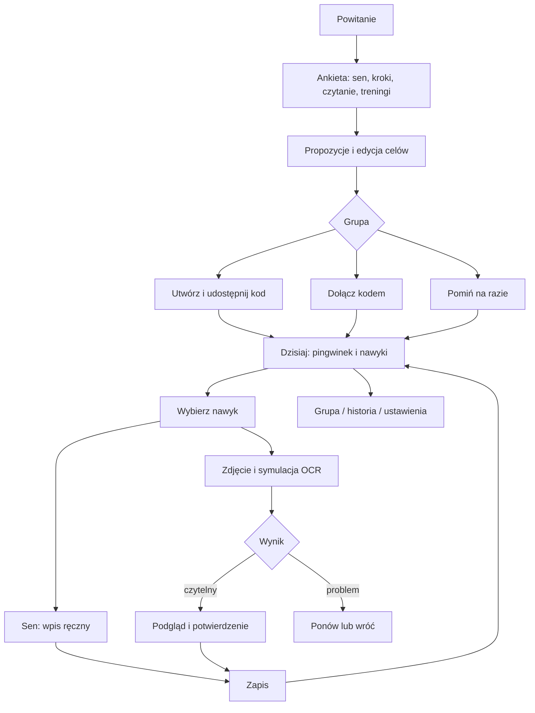

# Milestone 3 — UX/UI i prototyp

## Cel i sposób korzystania

Otwórz [Prototyp.html](Prototyp.html) w przeglądarce na komputerze lub telefonie. To lokalna makieta: pokazuje przykładowe dane i nie przechowuje ich po zamknięciu karty. Aparat, OCR, konta, zaproszenia, naliczanie punktów i synchronizacja są symulowane. Prototyp służy do sprawdzenia zrozumiałości ekranów, a nie do potwierdzenia działania aplikacji.

## Główny przepływ

Skróty obok telefonu otwierają dodatkowo przykładowe stany offline, problemu z aparatem, choroby pingwinka, propozycji kolejnego nawyku i rozpoczęcia z nowym pingwinkiem. W aplikacji mają wynikać z rzeczywistych zdarzeń i danych, a nie być stałymi przyciskami.

## Ekrany i decyzje UX

| Ekran | Cel użytkownika | Najważniejsza informacja / następny krok |
|---|---|---|
| Powitanie | Zrozumieć wspólną opiekę. | Ankieta i możliwość dołączenia do grupy. |
| Ankieta | Przekazać punkt wyjścia. | Opcja „nie wiem”, bez podawania szczegółowych danych znajomym. |
| Cele | Przejrzeć trzy cele i je zmienić. | Wzrost czytania i snu, informacja o częstotliwości. W makiecie dni są tylko przykładem. |
| Grupa | Utworzyć grupę, dołączyć lub pominąć. | 2–4 osoby, przykładowy kod i opis prywatności; jeden użytkownik może czekać na znajomych. |
| Dzisiaj | Sprawdzić pingwinka i wykonać nawyk. | Cel, status wpisu oraz stan synchronizacji. |
| Potwierdzenie | Wpisać strony lub sen, wykonać zdjęcie. | Zdjęcie jednej strony nie dowodzi liczby przeczytanych stron; poniżej 5 godzin snu daje 0 punktów. |
| Wynik / błąd | Sprawdzić rezultat albo wrócić. | Ponowienie zdjęcia, anulowanie i możliwość ręcznego wpisania snu. |
| Pingwinek | Zrozumieć stan zdrowia i wpływ grupy. | Zdrowy: próg tygodniowy; chory: ocena dzienna. |
| Grupa | Widzieć statusy znajomych. | Nazwy nawyków i status są współdzielone; wyniki liczbowe i zdjęcia prywatne. |
| Historia | Sprawdzić swoje wpisy. | Pusty stan i status oczekiwania. |
| Ustawienia | Znaleźć przypomnienia i przedłużenie. | Opis kosztu 14 dni streaka oraz wymogu potwierdzenia połączenia. |
| Nowy nawyk / nowy pingwinek | Przejrzeć następny krok bez presji. | Można odłożyć propozycję lub rozpocząć ustalanie celów od nowa. |

## Stany do obsługi w aplikacji

- **Brak grupy / brak nawyków lub historii:** czytelna informacja i przycisk wykonania pierwszego kroku. Makieta pokazuje brak grupy i pustą historię; oddzielny pusty stan listy nawyków należy dodać w implementacji.
- **Offline:** zapis lokalny jest oznaczony jako oczekujący; zwykły termin synchronizacji to 23:59 dnia wykonania w strefie grupy. Przedłużenie za 14 dni streaka wymaga potwierdzenia i daje czas do 23:59 następnego dnia. Ostateczny status zależy od potwierdzenia backendu.
- **Zdjęcie anulowane / aparat niedostępny / nieczytelne OCR:** bez naliczania punktów; użytkownik może spróbować ponownie lub wrócić. Dla snu dostępny wpis ręczny.
- **Nowy członek:** w pierwszym niepełnym tygodniu może pomagać, lecz nie szkodzi pingwinkowi. Ekran i treść informacji wymagają jeszcze zaprojektowania.
- **Choroba, dokładnie 75%, dzień odpoczynku, śmierć:** treści muszą wyjaśniać zasady bez wskazywania winnej osoby. Pasek zdrowia nie może polegać wyłącznie na kolorze.
- **Po dwóch tygodniach:** trzy sugestie zależne od wywiadu; użytkownik wybiera jedną lub odkłada o tydzień. Przykładowe nawyki w makiecie nie są gotowym algorytmem doboru.

## System wizualny do implementacji

- Tło `#F7FBFA`, tekst `#173345`, przycisk `#166674`, tekst pomocniczy `#526B76`, karty `#FFFFFF`; stany mają zarówno kolor, jak i opis tekstowy.
- Krótkie tytuły, etykiety nad polami, aktywne przyciski o wysokości co najmniej 46 px w makiecie; w Androidzie użyć co najmniej 48 dp obszaru dotykowego. Zachować systemowe skalowanie tekstu i widoczne zaznaczenie fokusu.
- Użyte ilustracje i ikony są demonstracyjne. Sposób przedstawienia chorego lub zmarłego pingwinka powinien zostać oceniony przez użytkowników pod kątem presji emocjonalnej.
- Prototyp nie zastępuje weryfikacji kontrastu, czytnika ekranu, powiększenia tekstu ani testów na urządzeniach. Należy je wykonać przy implementacji i udokumentować wyniki.

## Scenariusz badania z osobą spoza zespołu

**Status: nieprzeprowadzone.** Nie wpisywać wyników przed rzeczywistą próbą. Potrzebna co najmniej jedna osoba nieuczestnicząca w projekcie; prowadzący pokazuje prototyp, nie tłumaczy, gdzie klikać, a obserwator zapisuje trudności.

1. „Uruchom prototyp, odpowiedz na pytania, zmień cel czytania i zaproś znajomego.” Czy osoba rozumie, że kod jest przykładowy i jakie dane widzą znajomi?
2. „Dodaj czytanie i pokaż, co zrobisz, gdy zdjęcie będzie nieczytelne.” Czy znajduje możliwość ponowienia?
3. „Dodaj sen bez zdjęcia.” Czy odnajduje wpis ręczny i zauważa zasadę 5 godzin?
4. „Sprawdź, czy Twój wpis offline został już zaliczony.” Czy rozumie oczekiwanie na synchronizację i termin?
5. „Wyjaśnij własnymi słowami, od czego zależy zdrowie pingwinka, i odszukaj postęp znajomego.” Czy rozumie różnicę między progiem dziennym i tygodniowym oraz prywatnością?

Zapisz datę, urządzenie, scenariusz, czy zadanie ukończono samodzielnie, miejsca zawahania i wypowiedzi uczestnika. Nie zapisuj zbędnych danych osobowych. Dla każdego problemu wpisz wagę, propozycję poprawki i jej status. Po zmianach powtórz dotknięty scenariusz.

| Data / urządzenie | Zadanie | Wynik i zaobserwowany problem | Poprawka / status |
|---|---|---|---|
| Do uzupełnienia | 1–5 | Test nie został jeszcze przeprowadzony | Oczekuje |

## Kryteria ukończenia

- [x] Mapa ekranów, klikalna makieta i scenariusze główne oraz stany demonstracyjne.
- [x] Zapisane wskazówki wizualne i opis prywatności; rozróżnienie danych demonstracyjnych od realnych.
- [ ] Test z osobą spoza zespołu i zapis obserwacji.
- [ ] Poprawa problemów z testu oraz sprawdzenie kontrastu, dużego tekstu i czytnika ekranu na docelowym UI.
